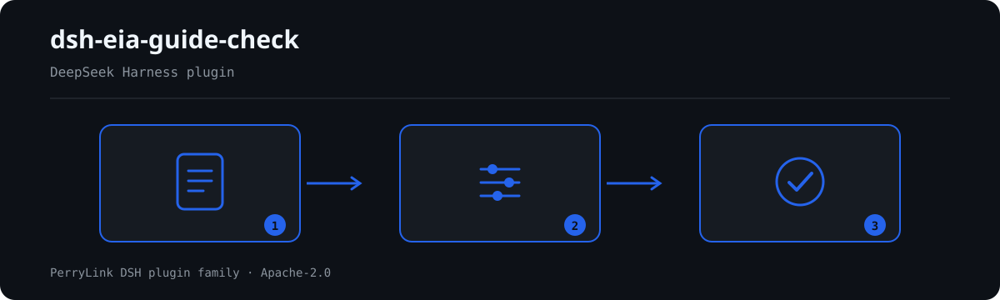

# dsh-eia-guide-check — Verificação da folha de aplicabilidade das diretrizes de avaliação de impacto ambiental

[English](README.md) · [简体中文](README-zh.md) · [Español](README-es.md) · [Português](README-pt.md) · [हिन्दी](README-hi.md)

[](https://dsh.market/)

`dsh-eia-guide-check` lê uma folha de aplicabilidade de diretrizes de uma avaliação de impacto ambiental —o cabeçalho do projeto mais uma linha por elemento avaliado— e verifica a rastreabilidade dessa própria folha: se cada elemento indica a diretriz que lhe é aplicável, se o número da diretriz segue a forma publicada, se o estado da diretriz vem do vocabulário que você configurar, se está registado um método de avaliação ou uma norma aplicável, se nenhum elemento está registado duas vezes, se o cabeçalho declara o projeto e o tipo de documento de avaliação, e se não resta nenhum marcador de modelo por substituir na coluna da norma aplicável.

## Install

```sh
dsh plugin --profile <name> add dsh-eia-guide-check
dsh --profile <name> --dump-config | grep 'dsh-eia-guide-check'
```

## Como é a saída



*Visão geral do fluxo: documento → regras → achados. Os exemplos abaixo usam a superfície real de comandos.*


Saída real deste plugin sobre o seu próprio fixture de teste `EG-001` — não é uma simulação. O pacote de regras não inventa citações, por isso cada achado nomeia a cláusula aplicada e avisa que o seu texto não foi obtido.

## O que ele responde

### Exemplos

A tabela abaixo é o conjunto de exemplos: a primeira linha é o caso detalhado e as demais são casos curtos.


| Você pergunta | O que ele responde |
|---|---|
| Uma linha de elemento deixa vazios o nome e o número da diretriz. Isso é reportado? | Sim. `EG-001` reporta essa linha quando `guideName` e `guideCode` estão ambos vazios, porque a linha tem de indicar pelo menos um deles. Verifica apenas se uma diretriz é indicada, nunca se é a correta para esse elemento: o plugin não inclui qualquer catálogo de diretrizes nem associa elementos a diretrizes. |
| O número da diretriz está escrito como `HJ 2.3`, sem ano. Isso é detetado? | Sim. `EG-002` verifica a forma «HJ número—ano de quatro dígitos», como em `HJ 2.3—2018`, pelo que um valor sem o ano de quatro dígitos não corresponde e é reportado linha a linha. Verifica apenas a forma: não que o número exista, não que esteja em vigor e não que corresponda ao nome ao lado. Uma célula `guideCode` vazia não é reportada aqui: os valores vazios ficam fora desta verificação de forma. |
| A coluna de estado diz `现行`. Porque é que nunca foi verificada? | Porque a lista `values` de `EG-003` vem vazia, ou seja, o vocabulário de estados ainda não está configurado: a regra reporta-se a si própria em `skipped`, com o motivo de que esse vocabulário é da instituição, em vez de passar em silêncio. Depois de configurado, verifica apenas se o valor preenchido consta da lista, não se a diretriz está realmente em vigor. |
| O método de avaliação está preenchido, mas a coluna da norma ainda diz `【待填】`. Isso é detetado? | `EG-004` exige apenas que um de `method` ou `standard` esteja preenchido, pelo que um método preenchido a satisfaz; não julga se o método é aplicável nem se a norma está correta. O marcador remanescente é reportado por `EG-007`, que procura na coluna da norma os termos configurados (`【`, `】`, `XXX`, `待填`, `TBD`, `示例` e semelhantes) e reporta o primeiro que encontra. Esses termos são ajustáveis, e uma célula de norma totalmente vazia não é reportada por nenhuma das duas regras. |
| O elemento `地表水` está registado duas vezes, uma para qualidade da água e outra para sedimentos. O que acontece? | `EG-005` reporta o valor repetido de `element` e indica com que linha anterior coincide, porque a repetição impede saber que diretriz rege esse elemento. Compara apenas o texto sem espaços e o resultado exige confirmação humana: avaliar um mesmo elemento por meio é normal, por isso escreva o subelemento no nome do elemento em vez de apagar a linha. Se a folha não tiver coluna `element`, a regra reporta que não pôde ser executada em vez de passar em silêncio. |
| O cabeçalho não traz o nome do projeto nem o tipo de documento de avaliação. O que acontece? | `EG-006` reporta que faltam ao cabeçalho `project` e `reportType`, porque o tipo de documento (`报告书`／`报告表`／`登记表`) determina que conjunto de requisitos se aplica. Verifica apenas que o cabeçalho os declare; não julga se a classificação do tipo está correta. |

## Normas que segue

| Documento | Número | Regras que o citam |
|---|---|---|
| 《环境影响评价技术导则》系列 | 各导则现行版本号本次未逐一核实 | EG-001, EG-002 |
| 本机构环评质量管理口径（本机构配置） | 无统一标准（本条依据为本机构配置的状态口径） | EG-003 |
| 《环境影响评价技术导则 总纲》 | HJ 2.1（现行版本号与条号本次未核实） | EG-004, EG-005, EG-007 |
| 《建设项目环境影响评价分类管理名录》 | 现行版本与条号本次未核实 | EG-006 |

**Boundary:** this plugin checks an **环评导则适用性核对表** for traceability — that each environmental element
names its applicable guideline, that the guideline number follows its published form, that the guideline's status
comes from your vocabulary, that an assessment method or an applicable standard is recorded, that elements are
not double-registered, that the sheet names its project and report type, and that no placeholder survives. It does
**not** decide whether an environmental assessment is compliant, whether the assessment level is right, whether a
prediction model applies, or whether the conclusions hold.

> ### ⚠️ What this plugin deliberately cannot do
>
> **It does not contain the guideline catalogue, and it does not map an element onto the guideline that should
> govern it.** Because of that it **cannot find the most consequential error: using the wrong guideline for an
> element.** Choosing between HJ 2.2, HJ 2.3, HJ 2.4, HJ 964 and the rest turns on the project's category and the
> element in question, and confirming it means reading the classification list and each guideline's scope. This
> limit is stated in the pack's header, in `EG-001`'s note, and in the troubleshooting section below.
>
> The 适用导则 column is therefore the register's own statement. Everything here checks what can be checked
> mechanically: is it written down, does the number look like a guideline number, is the status one you
> recognise, is a method or standard recorded.
>
> **The plugin also ships no current-version table** — tracking which guidelines are in force and which have
> been superseded means following the ministry's announcements, and the status vocabulary is yours to configure.
> `EG-002` checks the *form* of a number (`HJ 2.3—2018`) and never whether that number exists, is current, or
> matches the name next to it.
>
> **Every `excerpt` in the rule pack says, in so many words, that the clause text was not obtained** — the
> verification pass did not retrieve the guidelines' verbatim text, nor verify each one's current version.
> When the texts are in hand, replace each `excerpt` with the real clause and raise `kind` to `direct`.

## Compatibility

| Superfície | Estado |
|---|---|
| Harness | Faixa de peers `>=0.1.2-rc.1 <0.2.0 \|\| >=0.2.0-0 <0.3.0` — verificada para aceitar tanto `0.2.0-rc.2` quanto `0.2.1-rc.2`. **`engines.dsh` é declarado como `>=0.2.1-0 <0.3.0`** e o host o aplica desde 0.2.1 |
| Node | `^22.19.0 || >=24.0.0` |
| Plataformas | Todas (ESM puro; sem código nativo, sem rede, sem chamada ao modelo) |
| Modo de ferramenta | Funciona em `native` e `ptc`; para um diretório inteiro use `ptc` |

## What it does

A tabela de regras, os campos e o comportamento detalhado estão em [README.md](README.md#what-it-does) (versão principal em inglês). O plugin apenas lista divergências literais frente às cláusulas citadas e indica em `skipped` cada verificação que não pôde ser executada.

## Configuration

Todos os parâmetros ajustáveis ficam no esquema Schemastery de `src/config.ts`, portanto mudam pelo `cordis.yml` sem editar código; os limites por regra ficam no pacote de regras sob `rules/`.

| Chave | Tipo | Padrão | Descrição |
|---|---|---|---|
| `rulesFile` | string | `rules/eia-guide-check.yaml` | Caminho do pacote de regras, relativo à raiz do pacote |
| `disabledRules` | string[] | `[]` | Ids de regras a desativar; cada uma aparece em `skipped` |
| `onlyRules` | string[] | `[]` | Executar apenas estas regras; vazio executa todas |
| `skipNotes` | string | `""` | Nota acrescentada a cada motivo de `skipped` |
| `timeoutMs` | number | `120000` | Orçamento de tempo limite cooperativo da ferramenta |

## Material format

Aceita JSON ou YAML. O exemplo completo de campos está em [README.md](README.md#material-format) (versão principal em inglês). Os campos são opcionais na camada de leitura e validados pelo motor, de modo que uma exportação parcial gera achados sobre o que falta em vez de falhar.

## Rule sources

Os dados das regras ficam separados do código: cada regra traz documento, número, cláusula na numeração própria da fonte, trecho literal e URL de origem. O carregador impõe que o trecho seja citação real de pelo menos oito caracteres e que uma verificação baseada apenas em princípio geral (`kind: derived-from-principle`, teto `warn`) ou em política local (`kind: institutional-configuration`, teto `info`) nunca seja declarada `error`.

Os limites verificados e as conclusões deliberadamente **não** afirmadas estão em [README.md](README.md#rule-sources) (versão principal em inglês) .

## Troubleshooting

- **O plugin instala mas a ferramenta não aparece**: confirme que `main` resolve para `lib/index.mjs` e que `pnpm run build` o gerou.
- **`dsh plugin add` recusa o pacote**: a faixa de peers cobre `0.1.x` e `0.2.x`; fora dela, conceda isenção explícita com `dsh plugin --profile <name> allow-version <pkg@ver> --dsh-version <runtime> --accept-risk`.
- **Uma regra não executou**: leia o arranjo `skipped`.
- **`check` informa `manifest-peers` como falha**: problema conhecido do `dsh-plugin-dev`; o runtime aplica a compatibilidade na instalação.
- **Os horários parecem deslocados**: toda a aritmética é de hora local sobre as cadeias fornecidas.

## Development

```sh
pnpm install
pnpm run typecheck
pnpm test
pnpm run build
node ../scripts/sync-shared.mjs dsh-eia-guide-check
```

O último comando copia o kit compartilhado de `../_shared` para `src/shared/`; execute-o novamente após cada alteração compartilhada.

## PerryLink DSH Plugin Family

Este projeto faz parte da família de plugins do DeepSeek Harness da [PerryLink](https://github.com/PerryLink). O registro fica recolhido abaixo para que cada README mantenha uma primeira tela curta; expanda para ver cada linha e seu status.

<details>
<summary>Expandir todos os plugins</summary>

| Plugin | Status |
|---|---|
| **[dsh-aqua-input-check](https://github.com/PerryLink/dsh-aqua-input-check)** |  |
| **[dsh-archive-check](https://github.com/PerryLink/dsh-archive-check)** |  |
| **[dsh-auto-review](https://github.com/PerryLink/dsh-auto-review)** |  |
| **[dsh-autotier](https://github.com/PerryLink/dsh-autotier)** |  |
| **[dsh-bid-ca-precheck](https://github.com/PerryLink/dsh-bid-ca-precheck)** |  |
| **[dsh-bid-qual-check](https://github.com/PerryLink/dsh-bid-qual-check)** |  |
| **[dsh-cert-mcp](https://github.com/PerryLink/dsh-cert-mcp)** |  |
| **[dsh-checkpoint-rewind](https://github.com/PerryLink/dsh-checkpoint-rewind)** |  |
| **[dsh-click](https://github.com/PerryLink/dsh-click)** |  |
| **[dsh-composer-history](https://github.com/PerryLink/dsh-composer-history)** |  |
| **[dsh-contract-stance](https://github.com/PerryLink/dsh-contract-stance)** |  |
| **[dsh-customs-doc-check](https://github.com/PerryLink/dsh-customs-doc-check)** |  |
| **[dsh-data-quality](https://github.com/PerryLink/dsh-data-quality)** |  |
| **[dsh-demurrage-ledger](https://github.com/PerryLink/dsh-demurrage-ledger)** |  |
| **[dsh-doublecheck](https://github.com/PerryLink/dsh-doublecheck)** |  |
| **[dsh-drill-script-check](https://github.com/PerryLink/dsh-drill-script-check)** |  |
| **[dsh-eia-guide-check](https://github.com/PerryLink/dsh-eia-guide-check)** |  |
| **[dsh-emergency-plan](https://github.com/PerryLink/dsh-emergency-plan)** |  |
| **[dsh-essay-rubric-check](https://github.com/PerryLink/dsh-essay-rubric-check)** |  |
| **[dsh-evidence-check](https://github.com/PerryLink/dsh-evidence-check)** |  |
| **[dsh-export-ctl-check](https://github.com/PerryLink/dsh-export-ctl-check)** |  |
| **[dsh-fast](https://github.com/PerryLink/dsh-fast)** |  |
| **[dsh-fmea-table-check](https://github.com/PerryLink/dsh-fmea-table-check)** |  |
| **[dsh-forecast-penalty](https://github.com/PerryLink/dsh-forecast-penalty)** |  |
| **[dsh-fund-research](https://github.com/PerryLink/dsh-fund-research)** |  |
| **[dsh-github](https://github.com/PerryLink/dsh-github)** |  |
| **[dsh-gongwen-flow-check](https://github.com/PerryLink/dsh-gongwen-flow-check)** |  |
| **[dsh-gongwen-word-check](https://github.com/PerryLink/dsh-gongwen-word-check)** |  |
| **[dsh-guard-plan-qc](https://github.com/PerryLink/dsh-guard-plan-qc)** |  |
| **[dsh-hazchem-check](https://github.com/PerryLink/dsh-hazchem-check)** |  |
| **[dsh-hazplan-check](https://github.com/PerryLink/dsh-hazplan-check)** |  |
| **[dsh-hidden-risk-map](https://github.com/PerryLink/dsh-hidden-risk-map)** |  |
| **[dsh-hs-classify](https://github.com/PerryLink/dsh-hs-classify)** |  |
| **[dsh-icd-rule-check](https://github.com/PerryLink/dsh-icd-rule-check)** |  |
| **[dsh-industry-research](https://github.com/PerryLink/dsh-industry-research)** |  |
| **[dsh-lawcite-adapter](https://github.com/PerryLink/dsh-lawcite-adapter)** |  |
| **[dsh-laya](https://github.com/PerryLink/dsh-laya)** |  |
| **[dsh-lc-doc-check](https://github.com/PerryLink/dsh-lc-doc-check)** |  |
| **[dsh-learning-gap-check](https://github.com/PerryLink/dsh-learning-gap-check)** |  |
| **[dsh-library](https://github.com/PerryLink/dsh-library)** |  |
| **[dsh-local-ai](https://github.com/PerryLink/dsh-local-ai)** |  |
| **[dsh-lsp-actions](https://github.com/PerryLink/dsh-lsp-actions)** |  |
| **[dsh-mask](https://github.com/PerryLink/dsh-mask)** |  |
| **[dsh-mcp-panel](https://github.com/PerryLink/dsh-mcp-panel)** |  |
| **[dsh-medrec-qc](https://github.com/PerryLink/dsh-medrec-qc)** |  |
| **[dsh-memento](https://github.com/PerryLink/dsh-memento)** |  |
| **[dsh-nsfc-form-check](https://github.com/PerryLink/dsh-nsfc-form-check)** |  |
| **[dsh-nurse-record-check](https://github.com/PerryLink/dsh-nurse-record-check)** |  |
| **[dsh-observe](https://github.com/PerryLink/dsh-observe)** |  |
| **[dsh-origin-rvc-check](https://github.com/PerryLink/dsh-origin-rvc-check)** |  |
| **[dsh-ota-review-check](https://github.com/PerryLink/dsh-ota-review-check)** |  |
| **[dsh-output-styles](https://github.com/PerryLink/dsh-output-styles)** |  |
| **[dsh-paper-doc-adapter](https://github.com/PerryLink/dsh-paper-doc-adapter)** |  |
| **[dsh-permission-rules](https://github.com/PerryLink/dsh-permission-rules)** |  |
| **[dsh-permit-report-check](https://github.com/PerryLink/dsh-permit-report-check)** |  |
| **[dsh-pipeline-check](https://github.com/PerryLink/dsh-pipeline-check)** |  |
| **[dsh-pleading-draft](https://github.com/PerryLink/dsh-pleading-draft)** |  |
| **[dsh-plugin-doctor](https://github.com/PerryLink/dsh-plugin-doctor)** |  |
| **[dsh-plugin-guide](https://github.com/PerryLink/dsh-plugin-guide)** |  |
| **[dsh-plugin-kit](https://github.com/PerryLink/dsh-plugin-kit)** |  |
| **[dsh-plugin-upgrade](https://github.com/PerryLink/dsh-plugin-upgrade)** |  |
| **[dsh-policy-brief-draft](https://github.com/PerryLink/dsh-policy-brief-draft)** |  |
| **[dsh-power-loss-split](https://github.com/PerryLink/dsh-power-loss-split)** |  |
| **[dsh-power-ticket-check](https://github.com/PerryLink/dsh-power-ticket-check)** |  |
| **[dsh-ppap-check](https://github.com/PerryLink/dsh-ppap-check)** |  |
| **[dsh-protest-deadline](https://github.com/PerryLink/dsh-protest-deadline)** |  |
| **[dsh-railway-window](https://github.com/PerryLink/dsh-railway-window)** |  |
| **[dsh-repair-order-qc](https://github.com/PerryLink/dsh-repair-order-qc)** |  |
| **[dsh-research-report](https://github.com/PerryLink/dsh-research-report)** |  |
| **[dsh-review-reply-check](https://github.com/PerryLink/dsh-review-reply-check)** |  |
| **[dsh-rulefile-check](https://github.com/PerryLink/dsh-rulefile-check)** |  |
| **[dsh-safety-brief-check](https://github.com/PerryLink/dsh-safety-brief-check)** |  |
| **[dsh-score](https://github.com/PerryLink/dsh-score)** |  |
| **[dsh-session-sync](https://github.com/PerryLink/dsh-session-sync)** |  |
| **[dsh-site-log-check](https://github.com/PerryLink/dsh-site-log-check)** |  |
| **[dsh-skill-pack-security](https://github.com/PerryLink/dsh-skill-pack-security)** |  |
| **[dsh-soe-decision-check](https://github.com/PerryLink/dsh-soe-decision-check)** |  |
| **[dsh-soilwater-check](https://github.com/PerryLink/dsh-soilwater-check)** |  |
| **[dsh-sop-sync-check](https://github.com/PerryLink/dsh-sop-sync-check)** |  |
| **[dsh-spc-gbt-adapter](https://github.com/PerryLink/dsh-spc-gbt-adapter)** |  |
| **[dsh-talk](https://github.com/PerryLink/dsh-talk)** |  |
| **[dsh-tender-extract](https://github.com/PerryLink/dsh-tender-extract)** |  |
| **[dsh-tender-matrix](https://github.com/PerryLink/dsh-tender-matrix)** |  |
| **[dsh-test-drive](https://github.com/PerryLink/dsh-test-drive)** |  |
| **[dsh-ticktick](https://github.com/PerryLink/dsh-ticktick)** |  |
| **[dsh-translate](https://github.com/PerryLink/dsh-translate)** |  |
| **[dsh-warranty-calc](https://github.com/PerryLink/dsh-warranty-calc)** |  |
| **[dsh-budget](https://github.com/PerryLink/dsh-budget)** | 🧊 CONGELADO — ver o README do repositório |
| **[dsh-claude-move](https://github.com/PerryLink/dsh-claude-move)** | 🧊 CONGELADO — ver o README do repositório |
| **[dsh-defend](https://github.com/PerryLink/dsh-defend)** | 🧊 CONGELADO — ver o README do repositório |
| **[dsh-draw](https://github.com/PerryLink/dsh-draw)** | 🧊 CONGELADO — ver o README do repositório |
| **[dsh-reach](https://github.com/PerryLink/dsh-reach)** | 🧊 CONGELADO — ver o README do repositório |
| **[dsh-background-agents](https://github.com/PerryLink/dsh-background-agents)** | 🚫 RETIRADO — ver o README do repositório |
| **[dsh-session-pin](https://github.com/PerryLink/dsh-session-pin)** | 🚫 RETIRADO — ver o README do repositório |
| **[dsh-team-rooms](https://github.com/PerryLink/dsh-team-rooms)** | 🚫 RETIRADO — ver o README do repositório |

</details>

## License

[Apache License 2.0](LICENSE) © 2026 dsh-eia-guide-check contributors.
