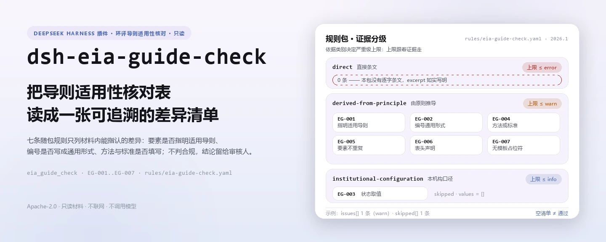
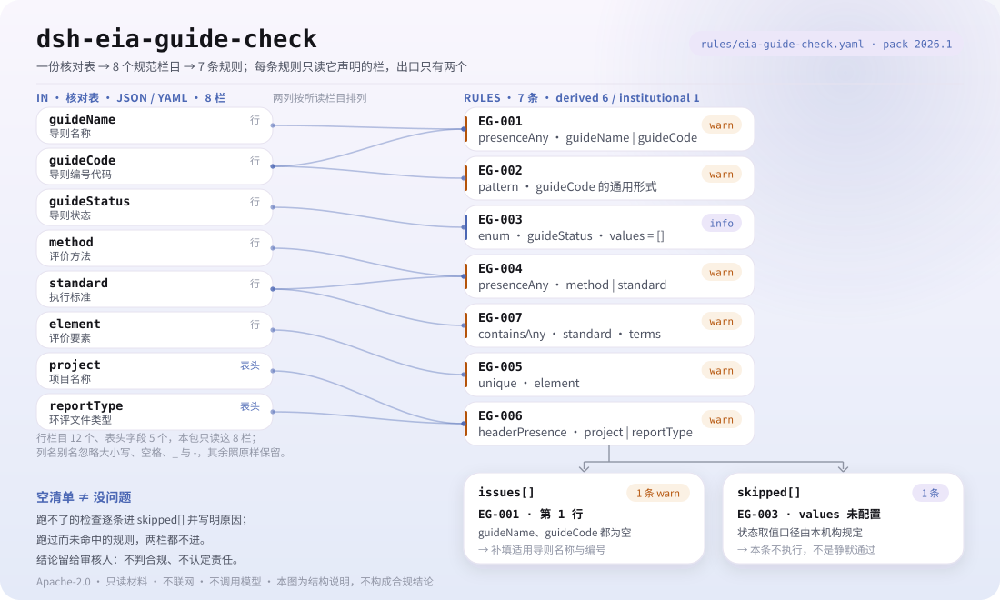

<div align="center">

<picture>
  <source media="(prefers-color-scheme: dark)" srcset="docs/assets/dsh-eia-guide-check-hero-zh-dark.webp">
  
</picture>

# dsh-eia-guide-check

**核对环评导则适用性核对表的可追溯性——输出「哪一行、哪一栏、差什么」的清单，结论留给审核人。**

面向 DeepSeek Harness 的数据型核查插件：读取一份环评导则适用性核对表（项目表头加每条评价要素一行），按随包的版本化规则包（EG-001..EG-007）逐条核对，只列材料内部能指认的差异，不判合规、不认定责任。

[安装](#三步上手) · [配置](#配置) · [FAQ](#faq) · [简体中文](README.md) · [English](README.en.md) · [Español](README.es.md) · [Português](README.pt.md) · [हिन्दी](README.hi.md)

[](LICENSE)
[](#兼容性)
[](https://www.npmjs.com/package/dsh-eia-guide-check)
[](https://github.com/PerryLink/dsh-eia-guide-check/actions/workflows/ci.yml)
[](#兼容性)

[](https://github.com/PerryLink/dsh-eia-guide-check/stargazers)
[](https://www.npmjs.com/package/dsh-eia-guide-check)
[](https://dshfind.com/plugins/PerryLink/dsh-eia-guide-check?ref=badge)
[](https://securityscorecards.dev/viewer/?uri=github.com/PerryLink/dsh-eia-guide-check)
[](https://dsh.market/)
[](https://gitee.com/perrylink/dsh-eia-guide-check)

```sh
dsh plugin --profile <name> add dsh-eia-guide-check
```

</div>

<sub>社区插件，与 DeepSeek 官方无关。唯一仓库：<https://github.com/PerryLink/dsh-eia-guide-check>（Gitee 为镜像）。</sub>

## 它是什么

`dsh-eia-guide-check` 读取一份环境影响评价的导则适用性核对表——项目表头，加上每条评价要素一行——并核对这份核对表自身是否可追溯：每条要素是否指明适用导则（名称或编号至少一项）、导则编号是否写成通用形式、导则状态是否取自你配置的取值、是否填写了评价方法或执行标准、要素是否重复登记、表头是否声明项目与环评文件类型、执行标准栏是否残留未替换的模板占位符。

它不判定环境影响评价是否合规、评价等级是否正确、预测模型是否适用，也不判定其结论是否成立。

- **给谁用**：环评编制人员、环保管理岗；不用懂命令行，在对话里把材料交给它即可。
- **你交什么**：这项核对用到的原始材料（表格、清单或文书）；不改原件。Excel 可先转成 JSON/YAML，对话里也能代转。
- **它交什么**：一份「哪一行、哪一栏、差什么、怎么补」的清单；没能执行的检查逐条列入 `skipped` 并写明原因。

<picture>
  <source media="(prefers-color-scheme: dark)" srcset="docs/assets/dsh-eia-guide-check-flow-v5-dark.svg">
  
</picture>

## 三步上手

1. **安装**（三选一）：

   ```sh
   # git 通道（最新 main；等价于 git+https://github.com/PerryLink/dsh-eia-guide-check.git）
   dsh plugin --profile <name> add github:PerryLink/dsh-eia-guide-check
   # npm 通道（已发布版本）
   dsh plugin --profile <name> add dsh-eia-guide-check
   # tarball 通道：本仓库 pnpm pack 后
   dsh plugin --profile <name> add ./dsh-eia-guide-check-<version>.tgz
   ```

   npm 通道装的是已构建的 `lib/`；git 通道在安装时由 `prepare` 脚本（tsdown）构建，无需手工编译。

2. **最小配置**（默认即可用；bundle 行不带 `config` 时全部走默认值，规则包路径指向随包的 `rules/eia-guide-check.yaml`）：

   ```yaml
   - insert:
       - id: dsh-eia-guide-check
         name: dsh-eia-guide-check
   ```

3. **验证已生效**：

   ```sh
   dsh --profile <name> --dump-config | grep 'dsh-eia-guide-check'
   ```

   然后把一份核对表交给它。仓内自带样例的期望输出（`samples/quickstart/expected/result.json`）：

   ```json
   {"tool":"eia_guide_check","issueCount":1,"summary":{"error":0,"warn":1,"info":0},"skippedCount":1}
   ```

   在本仓库内可复跑（需先 `pnpm run build` 产出 `lib/`）：

   ```sh
   node samples/quickstart/run.mjs --json
   ```

**卸载**：`dsh plugin --profile <name> remove dsh-eia-guide-check`（或从 profile patch 删掉该行）。

<details>
<summary>在 WorkBuddy / 扣子中使用</summary>

在 WorkBuddy / 扣子搜「职业文档核对全集」（总包，本检查是其中一项；上架以商城为准）即可调用同一套核对能力，无需命令行。

</details>

<details>
<summary>从 DSH Desktop 市场安装</summary>

所有 PerryLink 插件均可在 DSH Desktop 内置市场中浏览：**市场 → 来源 → 添加来源 → 粘贴** `https://perrylink-dsh-catalog.perrylink.workers.dev/catalog-source.json` **→ 选中**。安装仍需通过市场的 npm 身份校验与你的确认。

</details>

## 核心能力

`dsh-eia-guide-check` 注册 `eia_guide_check` 工具：读入一份导则适用性核对表，套用版本化规则包，返回一份报告。

- **七条规则一包带走** —— 规则包是数据不是代码（`rules/eia-guide-check.yaml`），换掉规则包即换掉整套检查，不动一行 TypeScript。
- **只读材料** —— 接受 JSON 或 YAML，原件永不修改；纯 ESM，无网络请求、不调用模型。
- **引文不造假** —— 每条规则带 `document` / `number` / `clause` / `excerpt` / `kind` / `source`；本规则包本次未取得任何导则的逐字条文，因此每条 `excerpt` 都如实写明「未取得」并标为 `derived-from-principle`，绝不把描述包装成引文。
- **严重级跟着证据走** —— `derived-from-principle` 最高 `warn`，本机构配置（`institutional-configuration`）最高 `info`，并有测试断言。
- **空清单 ≠ 没问题** —— 每条没能执行的检查都进 `skipped` 并写明原因；必填清单未配置的规则自我报告 `skipped`，绝不静默通过。
- **不内置导则清单** —— 它没有能力把评价要素映射到「应当适用哪本导则」，因此发现不了「该用 HJ 2.3 却用了别的导则」；那要查分类名录与各导则的适用范围。
- **措辞不作裁决** —— 报告只列差异，不判定合规、责任或正确性；措辞守卫（wording guard）强制执行，报告永远附带免责声明。

| 规则 | 核对内容 | 严重级 | 依据类别 |
|---|---|---|---|
| `EG-001` | 每条要素指明适用导则（名称或编号至少一项） | warn | principle |
| `EG-002` | 导则编号符合通用形式 | warn | principle |
| `EG-003` | 导则状态取自你配置的取值（默认关闭） | info | local |
| `EG-004` | 填写了评价方法或执行标准 | warn | principle |
| `EG-005` | 评价要素不在表内重复登记 | warn | principle |
| `EG-006` | 核对表声明项目与环评文件类型 | warn | principle |
| `EG-007` | 执行标准栏无未替换的模板占位符 | warn | principle |

### 示例

以下为插件真实入口；安装后调用一次即可。第一行是详细走查，其余是简短案例。

**详细示例** —— 工具 `eia_guide_check`，输入：

```json
{"rows":[{"序号":"1","评价要素":"环境空气","导则名称":"","导则编号代码":"", ...}]}
```

输出：

```json
{
  "id": "dsh-eia-guide-check.EG-001.de09b5a6",
  "ruleId": "EG-001",
  "severity": "warn",
  "locator": {
    "row": 1,
    "field": "guideName"
  },
  "found": "第 1 行 guideName、guideCode 都为空",
  "expected": "guideName、guideCode 至少应填写一项",
  "fix": "补填适用导则名称与编号；本条只核对是否指明，不判断适用是否正确"
}
```

*Observed from `dsh-eia-guide-check/tests/fixtures/EG-001/EG-001-unsafe.json; dsh-eia-guide-check/tests/fixtures/EG-001/cases.json; dsh-eia-guide-check/rules/eia-guide-check.yaml; dsh-eia-guide-check/tests/index.test.ts`*

| 你会问 | 它怎么答 |
|---|---|
| 某条要素行的适用导则名称与编号都是空的，会被报出吗？ | 会。`guideName` 与 `guideCode` 都为空时，`EG-001` 报出该行，因为这一行至少要指明其中一项。它只核对是否指明了导则，**不核对指明得对不对**：本插件不内置导则清单，也不做要素到导则的映射。 |
| 导则编号写成 `HJ 2.3`，没有年份，会被报出吗？ | 会。`EG-002` 按「HJ 数字—四位年份」的形式核对（如 `HJ 2.3—2018`），没有四位年份就匹配不上，会逐行报出。它只核对形式：不核对编号是否真实存在、是否现行有效，也不核对是否与旁边的名称对应。`guideCode` 栏为空时本条不报——空值不参与这项形式核对。 |
| 状态栏填的是 `现行`，为什么没查？ | 因为 `EG-003` 的 `values` 出厂为空，表示状态口径尚未配置：本条在 `skipped` 中报告自己不执行，并说明这一取值口径由本机构规定，而不是静默通过。配置之后，它也只核对所填值是否在册，不判断该导则是否真的现行有效。 |
| 评价方法填了，但执行标准栏还写着 `【待填】`，能查出来吗？ | `EG-004` 只要求 `method` 与 `standard` 至少填了一个，方法填了它就通过；它不判断方法是否适用、标准是否正确。残留的占位符由 `EG-007` 报出：它在执行标准栏里找配置的占位符词（`【`、`】`、`XXX`、`待填`、`TBD`、`示例` 等），报出命中的那一个。这些词可按本机构模板调整；执行标准栏整个为空时，这两条都不报。 |
| 同一要素 `地表水` 登记了两次，一次水质、一次底泥，会怎样？ | `EG-005` 报出重复的 `element` 值，并指出与哪一行重复，因为重复会让人无法判断该要素按哪一本导则评价。它只比对去掉空白后的字面值，且命中需要人工确认：同一要素分环境介质评价是常见情形，应在要素名称里写清子项，而不是简单删行。材料没有 `element` 栏时，本条报告无法执行，而不是静默通过。 |
| 表头没有项目名称，也没写环评文件类型，会怎样？ | `EG-006` 报出表头缺少 `project`、`reportType`，因为环评文件类型（`报告书`／`报告表`／`登记表`）决定了适用哪一套要求。它只核对表头是否声明，不判断该类型划分是否正确。 |

## 依据的标准

| 文件 | 文号 | 引用它的规则 |
|---|---|---|
| 《环境影响评价技术导则》系列 | 各导则现行版本号本次未逐一核实 | EG-001, EG-002 |
| 本机构环评质量管理口径（本机构配置） | 无统一标准（本条依据为本机构配置的状态口径） | EG-003 |
| 《环境影响评价技术导则 总纲》 | HJ 2.1（现行版本号与条号本次未核实） | EG-004, EG-005, EG-007 |
| 《建设项目环境影响评价分类管理名录》 | 现行版本与条号本次未核实 | EG-006 |

**边界：** 本插件核对一份 **环评导则适用性核对表** 的可追溯性——每个环境要素是否指明适用导则，导则编号是否写成通用形式，导则状态是否取自你配置的取值口径，是否填写了评价方法或执行标准，要素是否重复登记，表头是否声明项目与环评文件类型，以及是否残留占位符。它**不**判定环境影响评价是否合规、评价等级是否正确、预测模型是否适用，也不判定其结论是否成立。

> ### ⚠️ 在采信报告中的引文之前，请先读这一段
>
> **每条 `excerpt` 的状态逐条不同，不是统一的。** 有的规则引用逐字条文（`kind: direct`），有的按条文原则推导（`kind: derived-from-principle`，最高 `warn`），有的阈值由本机构配置（`kind: institutional-configuration`，最高 `info`）。规则包从不概括引文：取不到原文时，`excerpt` 会如实写明，推理写在 `note` 里；并有测试断言没有任何规则声称拥有它并不拥有的引文。**对仍标为「未取得原文」的规则，取得文本后必须把 `excerpt` 换成真实条款，并把 `kind` 提升为 `direct`。**
>
> 结论性判断留给审核人：本插件只列出材料内部可以逐条指认的差异，不判断事实真伪，也不评价合规性。

## 配置

全部可调参数都是 `src/config.ts` 里的 Schemastery `Config` 字段（可从 cordis.yml 覆盖），逐条阈值在 `rules/` 下的规则库文件里。按 id 覆盖会替换整行——请重述所有需要的键。

| 键 | 类型 | 默认值 | 说明 |
|---|---|---|---|
| `rulesFile` | string | `rules/eia-guide-check.yaml` | 规则库文件路径，相对插件包根目录 |
| `disabledRules` | string[] | `[]` | 要停用的规则 id 列表；每条都会出现在 `skipped` 中 |
| `onlyRules` | string[] | `[]` | 只执行这些规则 id；留空表示执行全部规则 |
| `skipNotes` | string | `""` | 附加到每条 `skipped` 说明后的备注 |
| `timeoutMs` | number | `120000` | 工具协作式超时预算（毫秒） |

值得了解的规则级参数：

- `EG-002` `pattern` —— 编号的形式，默认「HJ 数字（可带小数）—四位年份」。台账用别的写法时放宽它。
- `EG-003` `values` —— 你的状态取值口径，例如 `[现行, 已废止, 被替代, 部分适用]`。留空表示不核对；插件不内置任何现行版本表。
- `EG-007` `terms` —— 要查找的占位符词。

profile patch 覆盖示例：

```yaml
- insert:
    - id: dsh-eia-guide-check
      name: dsh-eia-guide-check
      config:
        disabledRules: [EG-003]
        timeoutMs: 180000
```

## 材料格式

工具接受 JSON 或 YAML：

```yaml
project: 某某建设项目
industry: 某某行业
reportType: 报告书
compiler: 某某环评单位
rows:
  - { 序号: '1', 评价要素: 环境空气, 导则名称: 环境影响评价技术导则 大气环境,
      导则编号代码: HJ 2.2—2018, 导则状态: 现行, 应用章节: 第 5 章 大气环境影响预测与评价,
      评价方法: AERMOD 预测模式, 评价范围: 二级评价，边长 5 km 矩形,
      评价因子: PM10、PM2.5、SO2、NOx, 执行标准: GB 3095—2012 环境空气质量标准 }
```

列名匹配忽略大小写，并忽略空格、下划线与连字符；台账自己的列名会被保留，因此发现里写明的列就是它实际读到的列。字段在读取层是可选的，由检查引擎校验，因此部分导出的材料会产生「缺项」类差异，而不是让程序崩溃。

## 规则来源

规则数据在 `rules/eia-guide-check.yaml`，与代码分离：每条规则都带文件名、文号、按原文自身编号体系的条款号、逐字摘录与来源地址。规则包头部完整写明：本插件不内置导则清单、不做要素到导则的映射、也未逐一核实各导则的现行版本；每条规则的 `note` 复述与该条相关的部分。加载期守卫要求 `document` / `clause` / `excerpt` / `source` 齐全，并禁止原则性推断（`derived-from-principle`）或本机构配置（`institutional-configuration`）的检查标为 `error`。`check:citations` 逐条核对引文：声称逐字引用的片段必须能对应到已取得的原文记录，本次未取得原文的规则作为占位计入；`rules/citations-baseline.json` 只能收缩。夸大依据的规则库会在加载期失败，而不会产出一份看起来很有底气的报告。

## FAQ

<details>
<summary>它会不会告诉我「某个要素用错了导则」？</summary>

不会，这是本插件最重要的能力边界。它不内置导则清单，也不做「评价要素 → 应当适用哪本导则」的映射；「适用导则」栏是台账自己写的，插件只核对它是否写了、编号形式是否成立、状态是否在你配置的取值里。要判断该用 HJ 2.2 还是 HJ 2.3，需要查《建设项目环境影响评价分类管理名录》与各导则的适用范围，结论留给环评工程师。

</details>

<details>
<summary>状态栏明明填了 `现行`，为什么 `EG-003` 从不报？</summary>

因为 `EG-003` 的 `values` 出厂为空，表示状态口径尚未配置：该规则在 `skipped` 中报告自己不执行，并说明这一取值口径由本机构规定，而不是静默通过。把 `values` 配成 `[现行, 已废止, 被替代, 部分适用]` 之后，它也只核对所填值是否在册，不判断该导则是否真的现行有效——那需要跟踪生态环境部的发布与废止公告，插件不内置版本表。

</details>

<details>
<summary>`issues` 为空能当作「没问题」吗？</summary>

不能。每条没能执行的检查都列在 `skipped` 里并写明原因（例如取值口径为空、材料缺 `element` 栏）。判读报告时请把 `issues` 与 `skipped` 一起看完；`skippedCount` 只统计真正没执行的规则，规则执行了且没有差异不算 `skipped`。

</details>

<details>
<summary>台账是 Excel，能直接用吗？</summary>

可以，先转成 JSON 或 YAML；平台支持时在对话里就能代为转换。工具只读材料，永不修改原件。

</details>

<details>
<summary>一次核对整份清单或整个目录，性能吃得消吗？</summary>

工具在 `native` 与 `ptc` 两种模式都能跑；批量校验（例如整套环评文件的适用性核对表）建议 `ptc`，schema 成本只付一次。检查本身是纯本地的列匹配，无网络请求、不调用模型；`timeoutMs`（默认 120 秒）是协作式超时预算。

</details>

## 排障

- **它没有报出「某要素用错了导则」。** 设计如此：它没有导则清单，也从不把要素映射到导则。请对着分类名录与各导则的适用范围自行确认。
- **`EG-002` 放过了一个我知道已废止的编号。** 本条只读编号的形式，从不读有效性或现行状态；跟踪版本是另一件事。
- **`EG-002` 误报了我写对的编号。** 模式要求 `HJ` 前缀、数字与四位年份以连字符或破折号相连。调整 `pattern`，或修正单元格。
- **`EG-003` 从不执行。** 它的取值口径为空；填入你质量管理体系使用的状态取值。
- **`EG-005` 对同一要素的两行报出重复。** 同一要素分环境介质评价是常见情形（例如地表水的水质与底泥）——在要素名称里写清子项，而不是删行。
- **插件装上了但工具不出现。** 确认 `main` 解析到 `lib/index.mjs`，且 `pnpm run build` 已产出该文件；`main` 写错会让加载器静默跳过该条目。
- **`dsh plugin add` 以不兼容为由拒绝安装。** peer 范围覆盖 `0.1.x` 与 `0.2.x`；若运行时在其之外，可显式豁免：`dsh plugin --profile <name> allow-version dsh-eia-guide-check@0.1.0 --dsh-version <runtime> --accept-risk`
- **`check` 把 `manifest-peers` 报为失败。** 静态检查器比对的是一份早于 0.2 世代的硬编码 peer 范围；安装期的 peer 校验以运行时为准，声明的范围才是正确的。这是 `dsh-plugin-dev` 的已知上游问题。

## 兼容性

| 项目 | 状态 |
|---|---|
| Harness | 对等版本范围 `>=0.1.2-rc.1 <0.2.0 \|\| >=0.2.0-0 <0.3.0` —— 已实测同时接受 `0.2.0-rc.2` 与 `0.2.1-rc.2`。已声明 `engines.dsh`：0.2.1 起由宿主单独裁决，范围为 `>=0.2.1-0 <0.3.0` |
| Node | `^22.19.0 \|\| >=24.0.0` |
| 平台 | 全平台（纯 ESM；无原生代码、无联网、不调用模型） |
| 工具模式 | `native` / `ptc` 均可；批量校验整个目录时建议 `ptc`，schema 成本只付一次 |

## 生态与质量

- [Gitee 镜像](https://gitee.com/perrylink/dsh-eia-guide-check)（同步镜像，以 GitHub 为准）
- [dshfind 插件页](https://dshfind.com/plugins/PerryLink/dsh-eia-guide-check)（安装量与排名）
- [OpenSSF Scorecard 报告](https://securityscorecards.dev/viewer/?uri=github.com/PerryLink/dsh-eia-guide-check)（由 [.github/workflows/scorecard.yml](.github/workflows/scorecard.yml) 驱动）
- [DSH Market](https://dsh.market/)（已上架）
- **1024 商店渠道**：先 `npm i -g dsh1024`，再 `dsh1024 plugin --profile <name> add dsh-eia-guide-check`（计入 [deepseek1024.com](https://deepseek1024.com) 安装排行）
- [生态实测知识库](https://perrylink.github.io/dsh-plugin-guide/)：插件开发指南 · 选型实测数据 · 维护取舍判据

## 开发

```sh
pnpm install                                        # node ^22.19 || >=24
pnpm run typecheck                                  # tsc --noEmit
pnpm test                                           # vitest：共享表格插件套件 + 成对夹具
pnpm run build                                      # tsdown -> lib/index.mjs + lib/index.d.mts
pnpm run verify:self-contained                      # 依赖 spec 均来自 registry
pnpm run check:lockfile                             # lockfile 漂移检查
pnpm run check:readmes                              # 五语 README 一致性
pnpm run check:citations                            # 规则包引文基线
node ../scripts/sync-shared.mjs dsh-eia-guide-check   # 从 ../_shared 刷新 src/shared
pnpm pack                                           # 发布 tarball
```

本插件是**数据型**的：`src/model.ts` 声明表格结构，共享套件提供读取器与检查引擎，规则包声明每一条检查。本地样例试跑（需先 `pnpm run build` 产出 `lib/`）：

```sh
node samples/quickstart/run.mjs --json
# => {"tool":"eia_guide_check","issueCount":1,"summary":{"error":0,"warn":1,"info":0},"skippedCount":1}
```

样例输入在 `samples/quickstart/input/`，期望输出在 `samples/quickstart/expected/result.json`，截图见 `docs/assets/quickstart.png`。README 配图由 [`scripts/gen-readme-assets.py`](scripts/gen-readme-assets.py) 程序化生成（Python + Pillow），可重复执行；旧的单版流程图与演示图保留在 `docs/assets/` 供外链使用，README 只引用新生成的深浅双版。

Topics：`deepseek-harness`, `dsh`, `dsh-plugin`, `cordis`, `eia`, `guide`

## 家族与致谢

本项目是 [PerryLink](https://github.com/PerryLink) 维护的 DeepSeek Harness 插件家族成员（全部 Apache-2.0）。完整家族索引见[按材料选核查器](https://perrylink.github.io/zh/checkers/choose/)与[全部插件](https://github.com/PerryLink)。如果这个插件帮到了你，**给个 star**——它不解锁任何功能，但会让下一个人更容易找到它。

- [@PerryLink](https://github.com/PerryLink) —— 创建者与维护者：数据型规则包（EG-001..EG-007）、`eia_guide_check` 工具、引文基线与五语文档。

<details>
<summary>展开全部插件</summary>

| 插件 | 状态 |
|---|---|
| **[dsh-aqua-input-check](https://github.com/PerryLink/dsh-aqua-input-check)** |  |
| **[dsh-archive-check](https://github.com/PerryLink/dsh-archive-check)** |  |
| **[dsh-auto-review](https://github.com/PerryLink/dsh-auto-review)** |  |
| **[dsh-autotier](https://github.com/PerryLink/dsh-autotier)** | 🧊 已冻结 — 见仓库 README |
| **[dsh-bid-ca-precheck](https://github.com/PerryLink/dsh-bid-ca-precheck)** |  |
| **[dsh-bid-qual-check](https://github.com/PerryLink/dsh-bid-qual-check)** |  |
| **[dsh-cert-mcp](https://github.com/PerryLink/dsh-cert-mcp)** | 🧊 已冻结 — 见仓库 README |
| **[dsh-checkpoint-rewind](https://github.com/PerryLink/dsh-checkpoint-rewind)** |  |
| **[dsh-click](https://github.com/PerryLink/dsh-click)** |  |
| **[dsh-composer-history](https://github.com/PerryLink/dsh-composer-history)** |  |
| **[dsh-contract-stance](https://github.com/PerryLink/dsh-contract-stance)** |  |
| **[dsh-customs-doc-check](https://github.com/PerryLink/dsh-customs-doc-check)** |  |
| **[dsh-data-quality](https://github.com/PerryLink/dsh-data-quality)** | 🧊 已冻结 — 见仓库 README |
| **[dsh-demurrage-ledger](https://github.com/PerryLink/dsh-demurrage-ledger)** |  |
| **[dsh-doublecheck](https://github.com/PerryLink/dsh-doublecheck)** |  |
| **[dsh-drill-script-check](https://github.com/PerryLink/dsh-drill-script-check)** |  |
| **[dsh-eia-guide-check](https://github.com/PerryLink/dsh-eia-guide-check)** |  |
| **[dsh-emergency-plan](https://github.com/PerryLink/dsh-emergency-plan)** |  |
| **[dsh-essay-rubric-check](https://github.com/PerryLink/dsh-essay-rubric-check)** |  |
| **[dsh-evidence-check](https://github.com/PerryLink/dsh-evidence-check)** |  |
| **[dsh-export-ctl-check](https://github.com/PerryLink/dsh-export-ctl-check)** |  |
| **[dsh-fast](https://github.com/PerryLink/dsh-fast)** |  |
| **[dsh-fmea-table-check](https://github.com/PerryLink/dsh-fmea-table-check)** |  |
| **[dsh-forecast-penalty](https://github.com/PerryLink/dsh-forecast-penalty)** |  |
| **[dsh-fund-research](https://github.com/PerryLink/dsh-fund-research)** |  |
| **[dsh-github](https://github.com/PerryLink/dsh-github)** |  |
| **[dsh-gongwen-flow-check](https://github.com/PerryLink/dsh-gongwen-flow-check)** |  |
| **[dsh-gongwen-word-check](https://github.com/PerryLink/dsh-gongwen-word-check)** |  |
| **[dsh-guard-plan-qc](https://github.com/PerryLink/dsh-guard-plan-qc)** |  |
| **[dsh-hazchem-check](https://github.com/PerryLink/dsh-hazchem-check)** |  |
| **[dsh-hazplan-check](https://github.com/PerryLink/dsh-hazplan-check)** |  |
| **[dsh-hidden-risk-map](https://github.com/PerryLink/dsh-hidden-risk-map)** |  |
| **[dsh-hs-classify](https://github.com/PerryLink/dsh-hs-classify)** |  |
| **[dsh-icd-rule-check](https://github.com/PerryLink/dsh-icd-rule-check)** |  |
| **[dsh-industry-research](https://github.com/PerryLink/dsh-industry-research)** |  |
| **[dsh-lawcite-adapter](https://github.com/PerryLink/dsh-lawcite-adapter)** |  |
| **[dsh-laya](https://github.com/PerryLink/dsh-laya)** |  |
| **[dsh-lc-doc-check](https://github.com/PerryLink/dsh-lc-doc-check)** |  |
| **[dsh-learning-gap-check](https://github.com/PerryLink/dsh-learning-gap-check)** |  |
| **[dsh-library](https://github.com/PerryLink/dsh-library)** |  |
| **[dsh-local-ai](https://github.com/PerryLink/dsh-local-ai)** |  |
| **[dsh-lsp-actions](https://github.com/PerryLink/dsh-lsp-actions)** |  |
| **[dsh-mask](https://github.com/PerryLink/dsh-mask)** |  |
| **[dsh-mcp-panel](https://github.com/PerryLink/dsh-mcp-panel)** |  |
| **[dsh-medrec-qc](https://github.com/PerryLink/dsh-medrec-qc)** |  |
| **[dsh-memento](https://github.com/PerryLink/dsh-memento)** | 🧊 已冻结 — 见仓库 README |
| **[dsh-nsfc-form-check](https://github.com/PerryLink/dsh-nsfc-form-check)** |  |
| **[dsh-nurse-record-check](https://github.com/PerryLink/dsh-nurse-record-check)** |  |
| **[dsh-observe](https://github.com/PerryLink/dsh-observe)** |  |
| **[dsh-origin-rvc-check](https://github.com/PerryLink/dsh-origin-rvc-check)** |  |
| **[dsh-ota-review-check](https://github.com/PerryLink/dsh-ota-review-check)** |  |
| **[dsh-output-styles](https://github.com/PerryLink/dsh-output-styles)** |  |
| **[dsh-paper-doc-adapter](https://github.com/PerryLink/dsh-paper-doc-adapter)** |  |
| **[dsh-permission-rules](https://github.com/PerryLink/dsh-permission-rules)** |  |
| **[dsh-permit-report-check](https://github.com/PerryLink/dsh-permit-report-check)** |  |
| **[dsh-pipeline-check](https://github.com/PerryLink/dsh-pipeline-check)** |  |
| **[dsh-pleading-draft](https://github.com/PerryLink/dsh-pleading-draft)** |  |
| **[dsh-plugin-doctor](https://github.com/PerryLink/dsh-plugin-doctor)** | 🚫 已退役（仓库已归档） |
| **[dsh-plugin-guide](https://github.com/PerryLink/dsh-plugin-guide)** |  |
| **[dsh-plugin-kit](https://github.com/PerryLink/dsh-plugin-kit)** | 🚫 已退役（仓库已归档） |
| **[dsh-plugin-upgrade](https://github.com/PerryLink/dsh-plugin-upgrade)** | 🚫 已退役（仓库已归档） |
| **[dsh-policy-brief-draft](https://github.com/PerryLink/dsh-policy-brief-draft)** |  |
| **[dsh-power-loss-split](https://github.com/PerryLink/dsh-power-loss-split)** |  |
| **[dsh-power-ticket-check](https://github.com/PerryLink/dsh-power-ticket-check)** |  |
| **[dsh-ppap-check](https://github.com/PerryLink/dsh-ppap-check)** |  |
| **[dsh-protest-deadline](https://github.com/PerryLink/dsh-protest-deadline)** |  |
| **[dsh-railway-window](https://github.com/PerryLink/dsh-railway-window)** |  |
| **[dsh-repair-order-qc](https://github.com/PerryLink/dsh-repair-order-qc)** |  |
| **[dsh-research-report](https://github.com/PerryLink/dsh-research-report)** |  |
| **[dsh-review-reply-check](https://github.com/PerryLink/dsh-review-reply-check)** |  |
| **[dsh-rulefile-check](https://github.com/PerryLink/dsh-rulefile-check)** |  |
| **[dsh-safety-brief-check](https://github.com/PerryLink/dsh-safety-brief-check)** |  |
| **[dsh-score](https://github.com/PerryLink/dsh-score)** | 🧊 已冻结 — 见仓库 README |
| **[dsh-session-sync](https://github.com/PerryLink/dsh-session-sync)** |  |
| **[dsh-site-log-check](https://github.com/PerryLink/dsh-site-log-check)** |  |
| **[dsh-skill-pack-security](https://github.com/PerryLink/dsh-skill-pack-security)** |  |
| **[dsh-soe-decision-check](https://github.com/PerryLink/dsh-soe-decision-check)** |  |
| **[dsh-soilwater-check](https://github.com/PerryLink/dsh-soilwater-check)** |  |
| **[dsh-sop-sync-check](https://github.com/PerryLink/dsh-sop-sync-check)** |  |
| **[dsh-spc-gbt-adapter](https://github.com/PerryLink/dsh-spc-gbt-adapter)** |  |
| **[dsh-talk](https://github.com/PerryLink/dsh-talk)** |  |
| **[dsh-tender-extract](https://github.com/PerryLink/dsh-tender-extract)** |  |
| **[dsh-tender-matrix](https://github.com/PerryLink/dsh-tender-matrix)** |  |
| **[dsh-test-drive](https://github.com/PerryLink/dsh-test-drive)** |  |
| **[dsh-ticktick](https://github.com/PerryLink/dsh-ticktick)** | 🚫 已退役（仓库已归档） |
| **[dsh-translate](https://github.com/PerryLink/dsh-translate)** |  |
| **[dsh-warranty-calc](https://github.com/PerryLink/dsh-warranty-calc)** |  |
| **[dsh-budget](https://github.com/PerryLink/dsh-budget)** | 🧊 已冻结 — 见仓库 README |
| **[dsh-claude-move](https://github.com/PerryLink/dsh-claude-move)** | 🧊 已冻结 — 见仓库 README |
| **[dsh-defend](https://github.com/PerryLink/dsh-defend)** | 🧊 已冻结 — 见仓库 README |
| **[dsh-draw](https://github.com/PerryLink/dsh-draw)** | 🧊 已冻结 — 见仓库 README |
| **[dsh-reach](https://github.com/PerryLink/dsh-reach)** | 🧊 已冻结 — 见仓库 README |
| **[dsh-background-agents](https://github.com/PerryLink/dsh-background-agents)** | 🚫 已退役（仓库已归档） |
| **[dsh-session-pin](https://github.com/PerryLink/dsh-session-pin)** | 🚫 已退役（仓库已归档） |
| **[dsh-team-rooms](https://github.com/PerryLink/dsh-team-rooms)** | 🚫 已退役（仓库已归档） |

</details>

## License

[LICENSE](LICENSE)（Apache License 2.0）© 2026 dsh-eia-guide-check contributors

<p align="center"><sub>Apache-2.0 · 社区插件，与 DeepSeek 无关。</sub></p>
